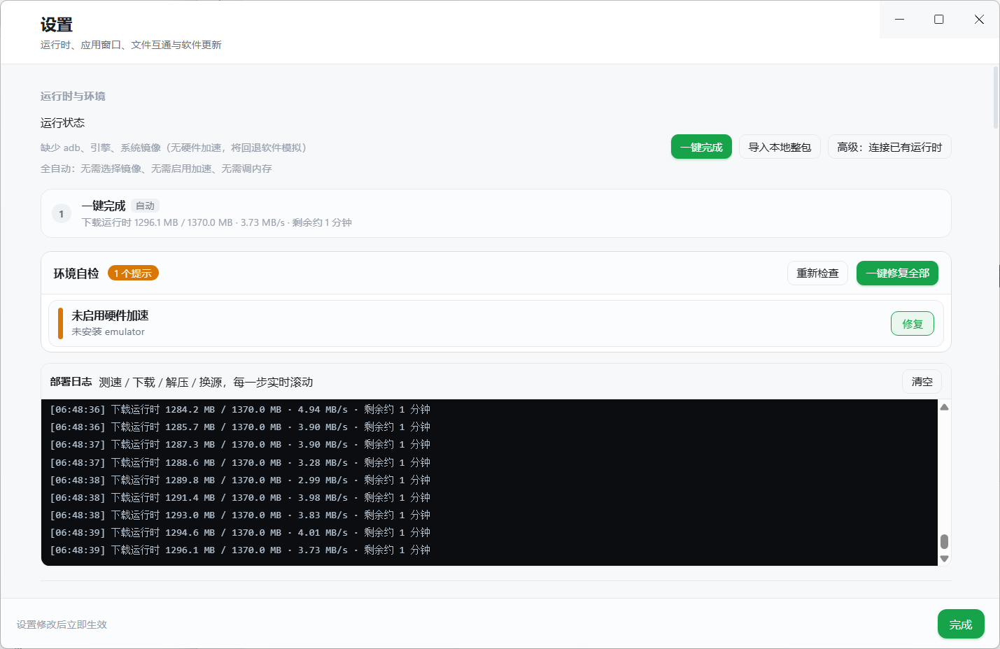

# ApkStart

<p align="center"><strong>Windows 上的安卓应用运行器</strong><br/>双击 APK 即安装，应用以独立窗口和桌面图标运行。</p>

<p align="center">
  <a href="https://github.com/yuchen0x1/apkstart/releases"></a>
  <a href="https://github.com/yuchen0x1/apkstart/actions/workflows/ci.yml"></a>
  <a href="LICENSE"></a>
  
</p>

ApkStart 是一个独立维护的 Windows 桌面应用。它负责下载和管理所需的 Android 运行时，把安卓应用包装成可以从桌面、开始菜单或资源管理器直接打开的 Windows 应用。

> 当前版本：**0.6.6**。完整变更记录见 [CHANGELOG.md](CHANGELOG.md) 和 [发布说明](docs/releases/release-notes.md)。

## 最新更新

### Unreleased（尚未发布）

- 低配机器会自动收敛内存、核心数、分辨率和渲染后端，启动失败时显示本次实际参数。
- 支持导入并独立启用自有的 x86_64 Android 模拟器镜像；导入失败不会改动当前默认运行时。
- 默认镜像统一为 Android 14 · Google Play · x86_64，Google APIs / AOSP 仍可在设置中显式选择。

完整历史与本地验证范围见 [CHANGELOG.md](CHANGELOG.md) 和 [发布说明](docs/releases/release-notes.md)；本节内容尚未对应已发布版本。

## 当前界面

首次启动会显示三步引导：选择安装位置、自动下载运行时、开始使用。默认推荐剩余空间较大的非系统盘，避免把 C 盘占满。

<p align="center">
  
</p>

运行时部署、环境自检、实时日志和修复入口都集中在全屏设置页中。

<p align="center">
  
</p>

## 能做什么

- **双击或拖入 APK 即安装**：支持选择文件、拖放文件，以及注册 `.apk` 关联后从资源管理器双击安装。
- **每个应用一个入口**：安装后生成桌面和开始菜单快捷方式，应用名称和图标从 APK 中提取。
- **独立应用窗口**：应用以独立窗口运行，支持全屏、窗口模式、拖动缩放和按应用记忆窗口尺寸。
- **首次运行向导**：自动选择运行时和安卓数据目录，显示下载进度；向导可以稍后在设置中重新打开。
- **运行时一键部署**：自动准备 adb、Android Emulator 和 Android 14 系统镜像，支持测速选源、断点续传、换源重试和本地整包导入。
- **自定义镜像适配**：可导入带清单的 x86_64 模拟器镜像，单独启用、停用或移除，不影响默认 AVD 和已装应用。
- **安装前兼容性检查**：安装前检查 Android 版本、ABI、Google Play 依赖、硬件特性和拆分 APK，并用中文说明风险。
- **文件互通**：`%USERPROFILE%\ApkStartShared` 与安卓侧 `/sdcard/ApkStartShared` 双向同步；冲突文件会保留副本，不会静默覆盖。
- **导出与备份**：可以导出 APK，也可以生成包含 `app.apk`、`meta.json` 和可选应用数据的备份目录；无法读取私有数据时会明确说明原因。
- **在线更新**：在「设置 → 软件更新」中检查更新，支持后台下载、安装前校验、失败回滚和安装后版本核对。
- **完整卸载**：卸载时清理 ApkStart 创建的应用、运行时、镜像、快照、日志、设置、共享目录和遗留快捷方式。

## 安装和首次使用

### 直接下载

从 [GitHub Releases](https://github.com/yuchen0x1/apkstart/releases) 下载：

| 文件 | 适合场景 |
|---|---|
| `ApkStart-v*-Setup.exe` | 安装版，包含完整运行时，首次安装后无需再下载运行时 |
| `ApkStart-v*-win64-portable.zip` | 便携版，解压即用，首次启动时下载运行时 |

安装版和便携版都会把运行时、安卓数据、应用和快照放在用户数据目录中，更新程序文件不会删除已安装应用。C 盘空间紧张时，可在「设置 → 系统集成」中修改运行时目录和安卓数据目录。

### 第一次启动

1. 在引导第一页点击「下一步」。
2. 选择安装位置和下载源；自动模式会先测速，再选择更快的来源。
3. 点击「开始安装」，等待 adb、模拟器和 Android 14 系统镜像部署完成。
4. 把 APK 拖进主窗口，或点击「安装 APK」选择文件。
5. 安装完成后双击桌面图标即可启动应用。

向导只在首次使用时自动显示。跳过后仍可以打开右上角「设置」→「运行时与环境」→「一键完成」。

## 系统要求

| 项目 | 要求 |
|---|---|
| 操作系统 | Windows 10/11 x64；Windows 7/8 不支持 |
| CPU | 建议 4 核及以上，并在 BIOS 中开启 VT-x/AMD-V |
| 内存 | 最低 8 GB，建议 16 GB |
| 磁盘 | 首次部署至少预留约 8 GB；安装大型应用需要更多空间 |
| 网络 | 首次部署需要联网；使用完整安装版时，运行时已随安装包提供 |

硬件加速可使用 AEHD 或 Windows 虚拟机平台（WHPX）。没有硬件加速时可以回退到软件模拟，但启动速度和流畅度会下降。部分依赖真实传感器、基带或强反模拟检测的应用仍可能无法运行。

## 设置页

设置页按功能分为以下区域：

- **运行时与环境**：一键部署、导入本地整包、连接已有运行时、环境自检、部署日志和修复操作。
- **应用窗口**：全屏/窗口模式、窗口尺寸记忆、鼠标键位和显示相关设置。
- **文件互通**：配置 Windows 共享目录、安卓侧目录和同步策略。
- **软件更新**：检查更新、选择更新源、设置代理和控制自动更新。
- **诊断与卸载**：导出脱敏诊断报告，或完整卸载 ApkStart。

## 从源码构建

环境要求：Windows x64、Node.js 20 或更高版本。

```powershell
# 安装依赖
npm install

# 启动开发版
npm start

# 可选：注册/取消注册 .apk 文件关联
npm run assoc:on
npm run assoc:off

# 打包便携版
npm run pack
# 产出：dist/ApkStart-win64-portable/ApkStart.exe

# 准备完整运行时并构建安装版
npm run build:exe
# 产出：dist/release/ApkStart-<版本>-Setup.exe
```

`npm run build:exe` 会先准备可分发的运行时，再调用 electron-builder 生成安装包。构建过程中会下载或整理 Android Emulator、adb 和系统镜像，因此需要足够磁盘空间和网络。

## 测试与自检

```powershell
# 纯 Node 测试，不需要网络和设备
npm test

# Electron 首屏、沙箱和 preload 冒烟测试
npm run test:electron

# 主进程 IPC 与页面自检
npm run test:app

# 已部署 Android 后，执行安装、启动、截图和共享目录验收
npm run selftest
```

测试覆盖 APK/AXML/资源解析、下载器和换源、更新器安全、共享目录同步、兼容性判定、备份恢复、IPC 来源校验、卸载清理和发布说明生成等模块。

## 项目结构

```text
src/main.js          Electron 主进程、窗口、托盘和 IPC
src/preload.js       安全桥接
src/ui/              主界面、首次运行向导和设置页
src/core/            APK 解析、安装、运行时、同步、备份和更新
engine/              本地运行时缓存与构建输入
build/               便携版和安装版构建脚本
scripts/              文件关联与自检脚本
test/                单元测试、Electron 测试和运行时验收工具
docs/                架构、兼容性、测试和发布文档
```

## 设计边界

ApkStart 使用 Android Emulator、QEMU、adb 和 Android 系统镜像作为运行基础，项目自身主要负责安装、窗口承载、运行时管理、文件同步、备份和更新体验。运行时下载和系统镜像遵循各自的上游许可协议，项目代码本身使用 MIT 许可证。

这是一个 Windows x64 应用，不提供 Linux 或 macOS 构建。安卓应用是否可用仍取决于 ABI、Google Play 服务、硬件依赖和应用自身的反模拟策略；安装前检查会尽量给出可操作的判断，但不能保证所有应用都能运行。

## 关于本仓库

本仓库是 [RoutineMiku/apkstart](https://github.com/RoutineMiku/apkstart) 的独立增强分支，由 [@yuchen0x1](https://github.com/yuchen0x1) 维护。欢迎提交 [Issue](https://github.com/yuchen0x1/apkstart/issues) 或 Pull Request。

- [贡献指南](CONTRIBUTING.md)
- [安全边界](SECURITY.md)
- [架构说明](docs/ARCHITECTURE.md)
- [自定义镜像适配层](docs/CUSTOM-IMAGES.md)
- [测试说明](docs/TESTING.md)
- [升级交付报告](docs/UPGRADE-REPORT.md)

## 许可证

[MIT](LICENSE)
