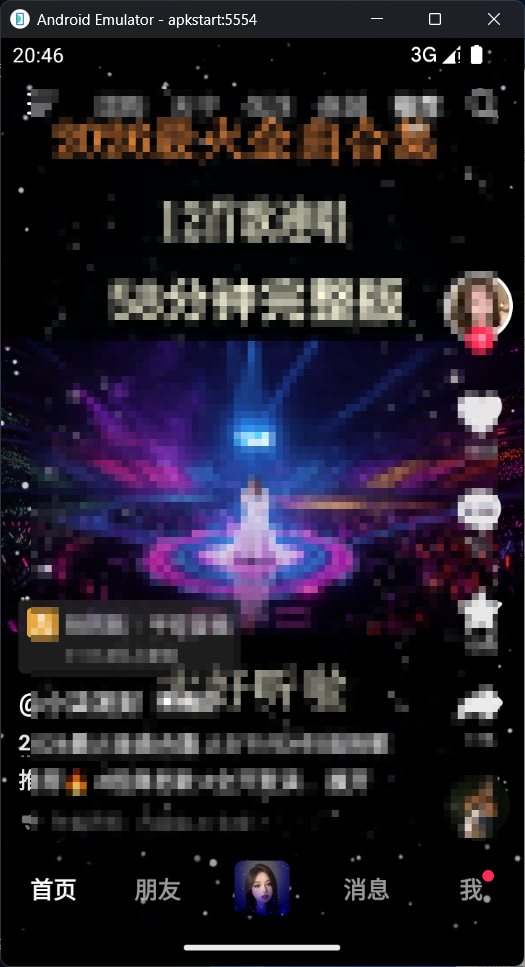

# ApkStart

<p align="center"><strong>在 Windows 上像本地软件一样运行安卓应用</strong><br/>
双击 APK 即安装，每个应用一个独立窗口 + 一个桌面图标，不用进模拟器里翻应用列表。</p>

<p align="center">
  <a href="https://github.com/yuchen0x1/apkstart/releases"></a>
  <a href="https://github.com/yuchen0x1/apkstart/releases"></a>
  <a href="https://github.com/yuchen0x1/apkstart/actions/workflows/ci.yml"></a>
  <a href="LICENSE"></a>
  
</p>

<p align="center">
  <a href="https://github.com/yuchen0x1/apkstart/releases/latest"><strong>⬇ 下载最新版</strong></a>
  ·
  <a href="CHANGELOG.md">变更记录</a>
  ·
  <a href="docs/COMPAT-MATRIX.md">兼容性实测</a>
  ·
  <a href="docs/ARCHITECTURE.md">架构说明</a>
</p>

<!-- version:start -->
> 当前版本：**0.6.9**（2026-11-16）。完整变更记录见 [CHANGELOG.md](CHANGELOG.md) 与 [GitHub Releases](https://github.com/yuchen0x1/apkstart/releases)。
<!-- version:end -->

ApkStart 是一个独立维护的 Windows 桌面应用。它负责下载和管理所需的 Android 运行时，
把安卓应用包装成可以从桌面、开始菜单、任务栏或资源管理器直接打开的 Windows 应用——
窗口是真 Windows 窗口（可拖动、缩放、全屏、贴边），不是模拟器里的一块画面。

> 想让安卓应用出现在 Windows 桌面上，又不想装一整套 Android Studio、不想每次开机手动点模拟器、
> 也不想应用和数据被塞在 C 盘的某个深层目录里，ApkStart 就是干这件事的。

## 为什么用它

| 常见做法 | 实际体验 | ApkStart 的做法 |
|---|---|---|
| 装 Android Studio / 官方模拟器 | 几个 GB 起，要会配 AVD、端口、镜像 | 一键部署运行时，装完就能拖 APK 进去 |
| 第三方安卓模拟器 | 一个大窗口里放所有应用，桌面一堆额外软件 | 每个应用独立窗口，和应用商店里「安卓应用上 PC」的体验一致 |
| 云手机 / 网页版安卓 | 依赖网络、延迟高、隐私不明 | 全部本地运行，数据留在自己电脑上 |
| 手动 adb install + scrcpy | 每次都要开命令行，关掉就没了 | 双击安装、点图标启动，关掉就停，不用记命令 |

## 最新更新

<!-- latest:start -->
### v0.6.9

- **设置面板改成「左侧分类 + 右侧内容」**：原来的所有分组堆在一个超长页面里，想改内存要一路往下滑，还经常滑过头找不到。现在分成通用 / 运行状态 / 性能与资源 /显示与操作 / 安卓系统 / 桌面与文件 / 下载与更新 / 高级 / 关于 九类，点左边名字进对应页；左栏顶部还加了搜索框，输入「内存 / 音量 / 快捷方式」直接列出命中项，点一条跳到那项并高亮。
- **「性能与资源」页把内存和 CPU 核心做成下拉框**（原来藏在「高级参数」里的数字输入框里，基本没人找得到）。旁边直接显示本机配置：「你的电脑：79.2 GB 内存 · 32 线程（当前可用 62.6 GB）」，以及自动算出来的参数，一眼能看出「是不是程序没看我的配置」。
- **首次开机的默认媒体音量从 50% 改为 100%**：镜像出厂经常是静音，第一次刷短视频没声音还以为坏了。现在全新 / 重置后的第一次开机直接把音量拉满；嫌吵在「安卓系统」页拉低即可，之后不会再动用户自己的调整。
- **内存 / CPU 核心不再写死封顶 3 GB / 4 核**：自动值原来按物理内存 22% 算但硬封顶 3072 MB，核心按线程数一半算但硬封顶 4 —— 32 线程、64 GB 的机器也只分到 3 GB / 4 核。现在按物理内存 1/4（2 GB 起、8 GB 封顶）、线程数一半（2 核起、8 核封顶）分配，并且 dalvik 堆跟着放大（6 GB 以上给 512 MB）。8 GB / 8 核之后是收益拐点：再往上安卓侧吃不到，只会让快速启动快照（ram.bin 约等于分配内存）成倍变大。
- **开机自启默认关闭**：以前默认随 Windows 登录常驻托盘，等于替所有人决定「开机就拉起一个后台进程」。需要的人可以在「设置 → 通用」里打开；已保存的配置不会被改写。
- **媒体音量拖到 100% 又自己跳回 0%**：`cmd media_session volume --get` 的真实输出前面带几行 `[V] will control stream=3 (STREAM_MUSIC)` 日志，旧解析取「前两个整数」，把 `stream=3` 当成当前音量、把后面的数字当成上限，于是状态页永远算出错值；状态汇总里又把多行输出塞进 `echo`（只截到第一行）后回退 dumpsys，而新镜像的 dumpsys 已没有 `streamVolume:` 字段，最终兜成 0 —— 界面上的滑杆就被拽回 0%。
<!-- latest:end -->

完整历史见 [CHANGELOG.md](CHANGELOG.md)。

## 界面与实测

首次启动会显示三步引导：选择安装位置、自动下载运行时、开始使用。默认推荐剩余空间较大的非系统盘，避免把 C 盘占满。

<p align="center">
  
</p>

设置页（左栏分类 + 右栏内容，顶部可搜索）。下图是「性能与资源」：内存 / CPU 核心是下拉框，
上面直接写着本机配置与自动算出来的参数：

<p align="center">
  
</p>

安装后的安卓应用在独立窗口里运行——下面是两个真实测试截图（K12 学习类应用、短视频类应用，
均为 arm64-v8a 包在 x86_64 运行时上通过 ARM 转译运行）：

<p align="center">
  
  &nbsp;&nbsp;
  
</p>

<p align="center"><em>左：学习类应用（搜索、信息流、底部导航均正常）；右：短视频应用（视频流、弹幕、直播入口均正常）</em></p>

## 能做什么

### 安装与启动

- **双击或拖入 APK 即安装**：支持选择文件、拖放文件，以及注册 `.apk` 关联后从资源管理器双击安装。
- **每个应用一个入口**：安装后生成桌面和开始菜单快捷方式，应用名称和图标从 APK 中直接提取。
- **独立应用窗口**：应用以独立窗口运行，支持全屏、窗口模式、拖动缩放，并按应用记忆窗口尺寸与位置。
- **后台常驻、点开秒进**：安卓环境只引导一次并常驻，配合快速启动快照与「接管已运行实例」，
  再次点开应用通常几秒进画面，而不是每次两分钟冷启动。
- **首次运行向导**：自动选择运行时和安卓数据目录，显示下载进度；向导可以稍后在设置中重新打开。

### 运行时管理

- **一键部署**：自动准备 adb、Android Emulator 和 Android 14 系统镜像，支持测速选源、断点续传、换源重试。
- **本地整包导入**：网络不好时可以先在别处下好运行时整包，再从本地导入，离线也能装。
- **自定义镜像适配**：可导入带清单的 x86_64 模拟器镜像，单独启用、停用或移除，不影响默认 AVD 和已装应用。
- **硬件加速检测**：自动识别 WHPX / AEHD，缺驱动时给出安装入口；没有硬件加速会明确提示「会慢」而不是假装没事。
- **首次开箱即用**：全新安卓数据第一次开机自动切换中文界面、把媒体音量拉满（默认 100%）。

### 兼容性与转译

- **安装前兼容性检查**：检查 Android 版本、ABI、Google Play 依赖、硬件特性和拆分 APK，并用中文说明风险。
- **ARM 应用可跑**：x86_64 运行时自带 ARM 转译（libndk_translation），抖音、快手这类只发 arm64 包的应用可以运行。
- **实测记录公开**：真实跑过的应用、环境、失败原因记录在 [docs/COMPAT-MATRIX.md](docs/COMPAT-MATRIX.md)，
  未验证的项目会明确写「未验证」，不做推测。

### 文件与数据

- **文件互通**：`%USERPROFILE%\ApkStartShared` 与安卓侧 `/sdcard/ApkStartShared` 双向同步；
  冲突文件保留副本，不会静默覆盖。
- **导出与备份**：可以导出 APK，也可以生成包含 `app.apk`、`meta.json` 和可选应用数据的备份目录；
  读不到私有数据时会说明原因（例如应用关闭了备份），而不是给你一个空包。
- **磁盘可控**：运行时目录、安卓数据目录、共享目录都能改到别的盘；设置页可直接看各部分占用并清理旧镜像/快照。

### 更新与卸载

- **在线更新**：在「设置 → 下载与更新」中检查更新，支持后台下载、安装前校验、失败回滚和安装后版本核对。
- **完整卸载**：卸载时清理 ApkStart 创建的应用、运行时、镜像、快照、日志、设置、共享目录和遗留快捷方式。
- **开机自启默认关闭**：不会偷偷常驻。需要的人可以在「设置 → 通用」里打开。

## 安装和首次使用

### 直接下载

从 [GitHub Releases](https://github.com/yuchen0x1/apkstart/releases/latest) 下载：

| 文件 | 体积 | 适合场景 |
|---|---|---|
| `ApkStart-<版本>-Setup.exe` | 约 1 GB | **推荐**。安装版，内置完整运行时，装完离线可用，不用等下载 |
| `ApkStart-v<版本>-win64-portable.zip` | 约 150 MB | 便携版，解压即用，首次启动时按需下载运行时 |
| `ApkStart-runtime-v<版本>.zip` | 约 1 GB | 运行时整包，便携版下载源；一般不需要手动下载 |

安装版和便携版都会把运行时、安卓数据、应用和快照放在用户数据目录中，更新程序文件不会删除已安装应用。
C 盘空间紧张时，可在「设置 → 桌面与文件」中修改运行时目录和安卓数据目录。

### 第一次启动

1. 在引导第一页点击「下一步」。
2. 选择安装位置和下载源；自动模式会先测速，再选择更快的来源。
3. 点击「开始安装」，等待 adb、模拟器和 Android 14 系统镜像部署完成。
4. 把 APK 拖进主窗口，或点击「安装 APK」选择文件。
5. 安装完成后双击桌面图标即可启动应用。

向导只在首次使用时自动显示。跳过后仍可以打开右上角「设置 → 运行状态」→「一键完成」。

## 系统要求

| 项目 | 要求 |
|---|---|
| 操作系统 | Windows 10/11 x64；Windows 7/8 不支持 |
| CPU | 建议 4 核及以上，并在 BIOS 中开启 VT-x/AMD-V |
| 内存 | 最低 8 GB，建议 16 GB |
| 磁盘 | 首次部署至少预留约 8 GB；安装大型应用需要更多空间 |
| 网络 | 首次部署需要联网；使用完整安装版时，运行时已随安装包提供 |

硬件加速可使用 AEHD 或 Windows 虚拟机平台（WHPX）。没有硬件加速时可以回退到软件模拟，
但启动速度和流畅度会明显下降。部分依赖真实传感器、基带或强反模拟检测的应用仍可能无法运行。

### 内存和 CPU 是怎么分的

自动值按本机硬件算，不是固定写死：

| 参数 | 自动规则 | 可手动范围 |
|---|---|---|
| 安卓可用内存 | 物理内存的 1/4，2 GB 起、8 GB 封顶 | 1.5 – 16 GB |
| vCPU 核心数 | 线程数的一半，2 核起、8 核封顶 | 2 – 8 核 |
| dalvik 堆 | 随内存放大，≥ 6 GB 给 512 MB | 自动 |

8 GB / 8 核之后是收益拐点：再往上安卓侧基本吃不到，只会让快速启动快照（`ram.bin` 约等于分配内存）成倍变大。
设置页「性能与资源」第一张卡会直接显示你的本机配置和实际生效的参数，改完重启运行时生效。

## 设置面板

设置页是「左侧分类 + 右侧内容」，左栏顶部可以搜索设置项：

| 分类 | 里面有什么 |
|---|---|
| 通用 | 语言、开机自启、更新提醒、启动行为 |
| 运行状态 | 运行时是否就绪、各组件状态、部署步骤、日志入口 |
| 性能与资源 | 内存 / CPU 核心、渲染方式、资源模式、快速启动快照、应用参数 |
| 显示与操作 | 窗口模式、窗口尺寸记忆、鼠标键位、分辨率与 DPI、字体缩放 |
| 安卓系统 | 媒体音量、Wi-Fi、飞行模式、动画开关、精简预装应用、中文化状态 |
| 桌面与文件 | 快捷方式重建、运行时 / 安卓数据 / 共享目录位置、磁盘占用与清理 |
| 下载与更新 | 更新源、代理、GitHub token、自动更新、版本核对 |
| 高级 | 自定义镜像、连接已有运行时、命令行参数、诊断导出 |
| 关于 | 版本号、数据目录、运行时目录、文档与协议入口 |

## 常见问题

**装完打不开 / 第一次启动很慢？**
第一次启动要初始化安卓数据（相当于新手机开机），1–3 分钟属于正常。之后走快速启动快照。
如果一直卡住，去「运行状态」看部署步骤停在哪一步，日志里会写明原因。

**提示没有硬件加速？**
BIOS 里开启 VT-x/AMD-V；Intel 平台可安装 AEHD，或启用 Windows 虚拟机平台（WHPX）。
没有加速也能跑，只是慢。

**应用能装但打不开 / 白屏 / 闪退？**
先看 [兼容性实测](docs/COMPAT-MATRIX.md)。常见原因：只发 arm64 包（可跑但慢）、
依赖 Google Play 服务（需要在「安卓系统」里换 Play 镜像）、依赖真实传感器或基带、应用自身检测模拟器。

**会改我的系统吗？**
只会在用户目录写数据，加一条 `.apk` 文件关联和（可选的）开机启动项。不装驱动、不改系统服务；
硬件加速驱动需要你自己点安装（AEHD），卸载时会提示如何移除。

**数据在哪？删软件会丢应用吗？**
程序文件和数据分开：卸载 / 覆盖更新只动程序文件，已装应用、存档、系统镜像都在数据目录里。
具体路径见「设置 → 关于」。

## 从源码构建

环境要求：Windows x64、Node.js 20 或更高版本。

```powershell
# 安装依赖
npm install

# 启动开发版
npm start

# 可选：注册/取消注册 .apk 文件关联
npm run assoc:on
npm run assoc:off

# 打包便携版
npm run pack
# 产出：dist/ApkStart-win64-portable/ApkStart.exe

# 准备完整运行时并构建安装版
npm run build:exe
# 产出：dist/release/ApkStart-<版本>-Setup.exe
```

`npm run build:exe` 会先准备可分发的运行时，再调用 electron-builder 生成安装包。
构建过程中会下载或整理 Android Emulator、adb 和系统镜像，因此需要足够磁盘空间和网络。

## 测试与自检

```powershell
# 纯 Node 测试，不需要网络和设备
npm test

# Electron 首屏、沙箱和 preload 冒烟测试
npm run test:electron

# 主进程 IPC 与页面自检
npm run test:app

# 已部署 Android 后，执行安装、启动、截图和共享目录验收
npm run selftest
```

测试覆盖 APK/AXML/资源解析、下载器和换源、更新器安全、共享目录同步、兼容性判定、备份恢复、
IPC 来源校验、卸载清理和发布说明生成等模块。测试说明见 [docs/TESTING.md](docs/TESTING.md)。

## 发布流程（维护者）

版本号只有两个来源：`package.json` 和 `CHANGELOG.md`。README 里的版本号与「最新更新」
由脚本生成，不要手改：

```powershell
npm run readme:sync    # 按 package.json 版本 + CHANGELOG 段落刷新 README
npm test               # README 版本与 package.json 不一致会直接失败
git tag v0.6.8 && git push origin v0.6.8   # 触发 .github/workflows/release.yml
```

发版工作流会依次：跑全量测试 → 用 `tools/release-notes.js` 生成发行说明并创建 Release →
构建并上传便携版、完整版安装包、运行时整包。

## 项目结构

```text
src/main.js          Electron 主进程、窗口、托盘和 IPC
src/preload.js       安全桥接
src/ui/              主界面、首次运行向导和设置页
src/core/            APK 解析、安装、运行时、同步、备份和更新
build/               便携版和安装版构建脚本、运行时组装
tools/               发行说明、README 同步、CI 检查脚本
scripts/             文件关联与自检脚本
test/                单元测试、Electron 测试和运行时验收工具
docs/                架构、兼容性、测试和发布文档
```

## 数据都放在哪

| 内容 | 默认位置 |
|---|---|
| 设置 / 应用清单 / 日志 | `%APPDATA%\apkstart` |
| 运行时（模拟器、adb、系统镜像） | 引导里选的目录，默认非系统盘 |
| 安卓用户数据与快照 | 运行时目录下的 `avd/apkstart.avd` |
| 与安卓互通的文件 | `%USERPROFILE%\ApkStartShared` ↔ `/sdcard/ApkStartShared` |

这些目录都可以在「设置 → 桌面与文件」里改到别的盘，改完重启软件生效。

## 设计边界

ApkStart 使用 Android Emulator、QEMU、adb 和 Android 系统镜像作为运行基础，
项目自身主要负责安装、窗口承载、运行时管理、文件同步、备份和更新体验。
运行时下载和系统镜像遵循各自的上游许可协议，项目代码本身使用 MIT 许可证。

这是一个 Windows x64 应用，不提供 Linux 或 macOS 构建。安卓应用是否可用仍取决于 ABI、
Google Play 服务、硬件依赖和应用自身的反模拟策略；安装前检查会尽量给出可操作的判断，
但不能保证所有应用都能运行。完整限制说明见 [SECURITY.md](SECURITY.md)。

## 关于本仓库

本仓库是 [RoutineMiku/apkstart](https://github.com/RoutineMiku/apkstart) 的独立增强分支，
由 [@yuchen0x1](https://github.com/yuchen0x1) 维护。欢迎提交
[Issue](https://github.com/yuchen0x1/apkstart/issues) 或 Pull Request。

- [贡献指南](CONTRIBUTING.md)
- [安全边界](SECURITY.md)
- [架构说明](docs/ARCHITECTURE.md)
- [代码走读](docs/CODE-WALKTHROUGH.md)
- [兼容性实测记录](docs/COMPAT-MATRIX.md)
- [自定义镜像适配层](docs/CUSTOM-IMAGES.md)
- [测试说明](docs/TESTING.md)
- [升级交付报告](docs/UPGRADE-REPORT.md)

## 许可证

[MIT](LICENSE)

## 项目星图

点击下方图表可查看 ApkStart 在 GitHub 上的 Star 增长历史：

<p align="center">
  <a href="https://www.star-history.com/?repos=yuchen0x1%2Fapkstart&type=date&legend=top-left">
    <picture>
      <source media="(prefers-color-scheme: dark)" srcset="https://api.star-history.com/chart?repos=yuchen0x1/apkstart&type=date&theme=dark&legend=top-left" />
      <source media="(prefers-color-scheme: light)" srcset="https://api.star-history.com/chart?repos=yuchen0x1/apkstart&type=date&legend=top-left" />
      
    </picture>
  </a>
</p>
