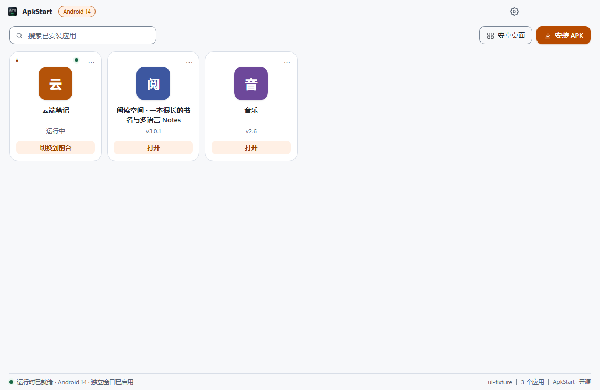
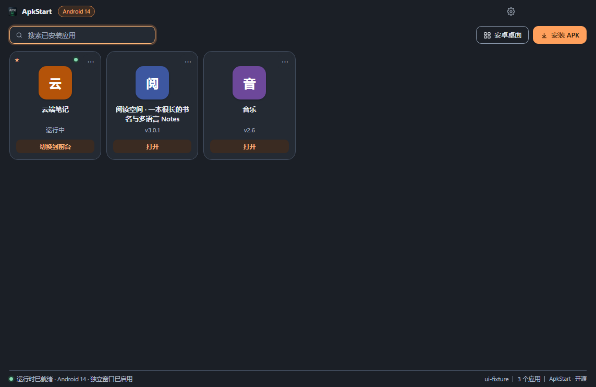
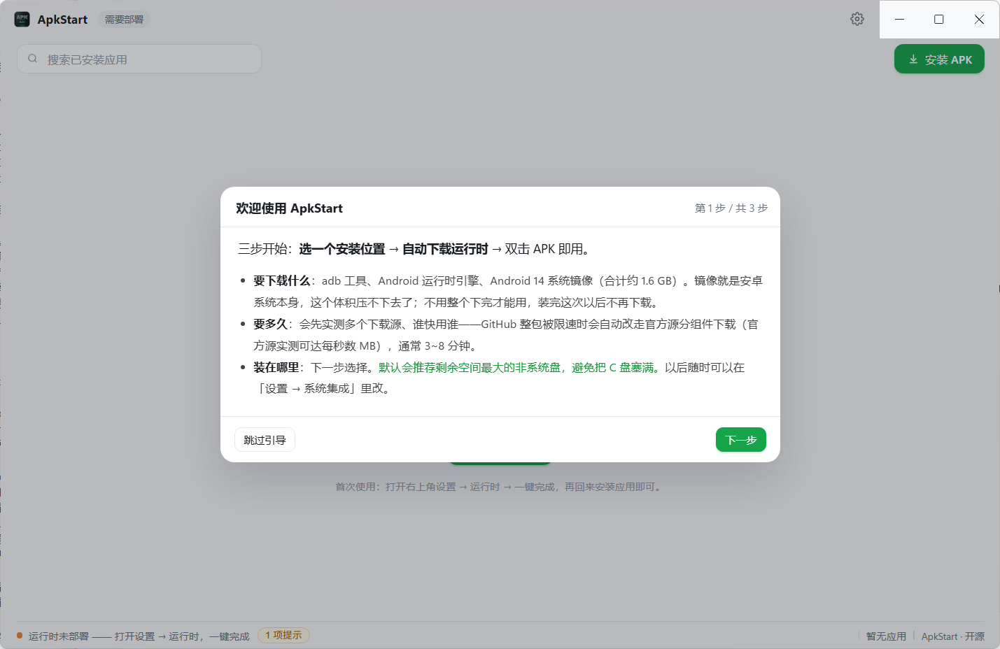
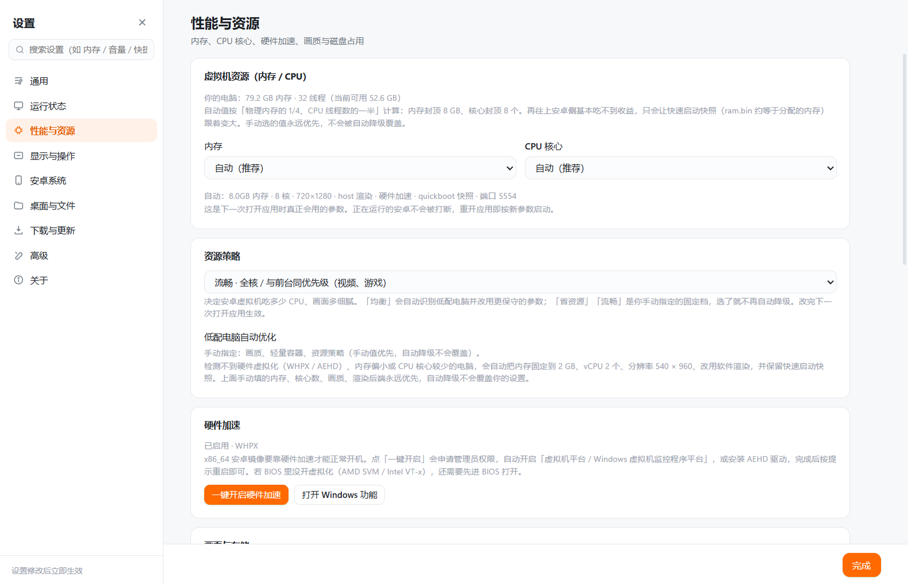

# ApkStart

<p align="center"><strong>在 Windows 和 Linux 上像本地软件一样运行安卓应用</strong><br/>
双击 APK 即安装，每个应用一个独立窗口 + 一个桌面图标，不用进模拟器里翻应用列表。</p>

<p align="center">
  <a href="https://github.com/yuchen0x1/apkstart/releases"></a>
  <a href="https://github.com/yuchen0x1/apkstart/releases"></a>
  <a href="https://github.com/yuchen0x1/apkstart/actions/workflows/ci.yml"></a>
  <a href="LICENSE"></a>
  
</p>

<p align="center">
  <a href="https://github.com/yuchen0x1/apkstart/releases/latest"><strong>⬇ 下载最新版</strong></a>
  ·
  <a href="CHANGELOG.md">变更记录</a>
  ·
  <a href="docs/COMPAT-MATRIX.md">兼容性实测</a>
  ·
  <a href="docs/ARCHITECTURE.md">架构说明</a>
</p>

<!-- version:start -->
> 当前版本：**0.11.7**（2026-11-25）。完整变更记录见 [CHANGELOG.md](CHANGELOG.md) 与 [GitHub Releases](https://github.com/yuchen0x1/apkstart/releases)。
<!-- version:end -->

ApkStart 是一个独立维护的 Windows / Linux 桌面应用。它负责下载和管理所需的 Android 运行时，
把安卓应用包装成可以从桌面、开始菜单、任务栏或应用菜单直接打开的桌面应用——Windows 上是可拖动、
缩放、全屏、贴边的独立窗口，Linux 上也以独立模拟器窗口运行，不用进入模拟器列表找应用。

> 想让安卓应用出现在桌面上，又不想装一整套 Android Studio、不想每次开机手动点模拟器、
> 也不想应用和数据被塞在系统盘的某个深层目录里，ApkStart 就是干这件事的。

## 为什么用它

| 常见做法 | 实际体验 | ApkStart 的做法 |
|---|---|---|
| 装 Android Studio / 官方模拟器 | 几个 GB 起，要会配 AVD、端口、镜像 | 一键部署运行时，装完就能拖 APK 进去 |
| 第三方安卓模拟器 | 一个大窗口里放所有应用，桌面一堆额外软件 | 每个应用独立窗口，和应用商店里「安卓应用上 PC」的体验一致 |
| 云手机 / 网页版安卓 | 依赖网络、延迟高、隐私不明 | 全部本地运行，数据留在自己电脑上 |
| 手动 adb install + scrcpy | 每次都要开命令行，关掉就没了 | 双击安装、点图标启动，关掉就停，不用记命令 |

## 最新更新

[查看 GitHub 当前正式发行及分平台下载](https://github.com/yuchen0x1/apkstart/releases/latest)

<!-- latest:start -->
### v0.11.7

> 修复旧 GPU 失败记录长期压制硬件渲染的问题，并分开展示当前运行参数与下次启动计划。

- 自动渲染不再依据缺少诊断证据、时间或显示环境的旧失败记录长期避开 `host`，符合当前显卡与资源条件时恢复硬件渲染尝试；普通退出、ADB 故障或启动超时不再写入 GPU 失败记录。
- 只有明确的 `GPU_INIT` / `GPU_MODE` 诊断才对同一运行时、显卡驱动与显示环境的后端短期退避，最长 24 小时；记录过期、环境变化或该后端启动成功后恢复正常自动选路。
- Qt 单条 `UpdateLayeredWindowIndirect failed` 窗口合成警告不再误判为显卡初始化失败，避免正常开机超过早期检查时间后被提前中止或记入 GPU 失败记录；诊断说明仍保留该警告的含义。
- 设置页和真实启动共享候选顺序；手动固定渲染后端继续优先，不被自动退避或窗口兼容策略替换。
- 性能页分别显示“当前运行实际参数”和“下次启动预期参数”，另行说明下次启动选档依据；两组参数不同时提示停止运行时再启动按计划尝试，不把参数差异等同于刚保存过设置，也不把预期 `host` 当作当前已使用的后端。
- 本地最终完整 `npm test` 通过，含 GPU 自动恢复、参数 IPC、界面状态和 Qt 警告跨过早期检查窗口仍继续开机的行为回归。PowerShell 原生窗口行为等用例按本机环境条件跳过，未改变系统策略。隔离 Electron 界面审计通过，未发现错误、溢出或未标注控件。
<!-- latest:end -->

完整发行历史见 [发行说明](docs/releases/release-notes.md)；开发变更记录见 [CHANGELOG.md](CHANGELOG.md)。
本轮实现、六个官方开源项目对比与验收边界见 [0.9.4 升级记录](docs/EVOLUTION-0.9.4.md)。

## 界面与实测

### 0.9.3 隔离界面测试

下图由真实 Electron / Chromium 渲染，应用列表、运行状态与失败响应由隔离内存 IPC 夹具提供。没有启动 Android 客机或产品主进程，不是真实 Android 画面，也不是安装、磁盘扩容或启动成功的证据。新增截图来自本轮 UI 审核夹具，不代表集成后的最终测试已经通过。

<p align="center">
  
  
</p>

夹具中的失败反馈：[扩容失败](docs/screenshots/v0.9.3/capacity-apply-failed.png) · [无法确认系统安装完成](docs/screenshots/v0.9.3/mark-installed-failed.png)。

本轮系统操作与授权提示截图：[浅色系统切换中的取消入口](docs/screenshots/v0.9.3/light-system-switch-cancel.png) · [深色停止失败反馈](docs/screenshots/v0.9.3/dark-system-stop-error.png) · [硬件加速检查（中文）](docs/screenshots/v0.9.3/accel-checking.png) · [Hardware acceleration check（English）](docs/screenshots/v0.9.3/accel-checking-english.png)。取消入口截图不证明取消已完成；检查提示不证明驱动已安装或加速已生效。

### 历史界面与 Android 实机记录

以下为既有截图，不作为 0.9.3 的运行时或升级验收证据。

首次启动会显示三步引导：选择安装位置（Windows）或确认 Linux 数据目录、自动下载运行时、开始使用。
Windows 默认推荐剩余空间较大的非系统盘，Linux 使用 XDG 数据目录。

<p align="center">
  
</p>

设置页（左栏分类 + 右栏内容，顶部可搜索）。下图是「性能与资源」：内存 / CPU 核心是下拉框，
上面直接写着本机配置与自动算出来的参数：

<p align="center">
  
</p>

安装后的安卓应用在独立窗口里运行——下面是两个真实测试截图（K12 学习类应用、短视频类应用，
均为 arm64-v8a 包在 x86_64 运行时上通过 ARM 转译运行）：

<p align="center">
  
  &nbsp;&nbsp;
  
</p>

<p align="center"><em>左：学习类应用（搜索、信息流、底部导航均正常）；右：短视频应用（视频流、弹幕、直播入口均正常）</em></p>

## 多系统按需下载与一键切换

除了内置的 Google Play / Google APIs / 纯 AOSP，ApkStart 还支持 **LineageOS、Bliss OS、Android-x86**
和自定义镜像，全部通过统一的 Provider 架构管理。

- **不内置、不预下载**：三个系统的镜像本体绝不在主程序、源码仓库或默认安装包里。下载主程序时不会额外下载它们；
  只有在「设置 → 安卓系统 → 选择系统」里主动选择，才会触发对应镜像的下载与安装。已下载的不重复下载，不用的不占磁盘。
- **真实进度**：下载 / 校验 / 建盘 / 安装 / 启动的进度全部显示在「设置 → 运行状态 → 系统任务」区域，
  含真实速度、已下载/总大小、剩余时间、当前阶段，支持暂停/继续/取消/重试。
- **系统切换**：对已安装系统请求停旧启新，各系统独立 userdata。Provider 状态未知不视为已停止；停止失败或无法确认时报告原因，不宣称切换成功。切换期间可请求取消，仍需等待在途操作收尾，取消进行中不等于已停止，也不撤销已发出的操作。

三个系统的真实接入状态（详见 [docs/SYSTEMS.md](docs/SYSTEMS.md)）：

| 系统 | 后端 | 状态 |
|---|---|---|
| Android-x86 9.0-r2 | QEMU | ✅ 官方 ISO + SHA-256，可下载安装（Windows 真机启动需用户环境验证） |
| Bliss OS 16.9.7 | QEMU | ⚠️ 官方 SourceForge 归档快照，可下载安装，无 OTA/支持 |
| LineageOS | Android Emulator | ⛔ 官方无预构建镜像，提供导入自建 AVD 镜像能力，显示真实状态 |

> LineageOS 没有官方预构建模拟器镜像，ApkStart 不会伪造下载地址；Bliss OS 官网已声明
> "No current official ISO"。虚拟磁盘启动不等于 Android 启动成功——只有 ADB 就绪且
> `sys.boot_completed=1` 才标记运行中。兼容性详见 [docs/COMPATIBILITY.md](docs/COMPATIBILITY.md)。

## 能做什么

### 安装与启动

- **双击或拖入 APK 即安装**：支持选择文件、拖放文件，以及注册 `.apk` 关联后从资源管理器双击安装；
  QQ / 迅雷 / 浏览器留下的 `xxx.apk.1` 这类下载残留后缀也照装不误。
- **每个应用一个入口**：安装后生成桌面和开始菜单快捷方式，应用名称和图标从 APK 中直接提取。
- **独立应用窗口**：应用以独立窗口运行，支持全屏、窗口模式、拖动缩放，并按应用记忆窗口尺寸与位置。
- **后台常驻、点开秒进**：安卓环境只引导一次并常驻，配合快速启动快照与「接管已运行实例」，
  再次点开应用通常几秒进画面，而不是每次两分钟冷启动。
- **首次运行向导**：自动选择运行时和安卓数据目录，显示下载进度；向导可以稍后在设置中重新打开。

### 运行时管理

- **一键部署**：自动准备 adb、Android Emulator 和 Android 14 系统镜像，支持测速选源、断点续传、换源重试。
- **本地整包导入**：网络不好时可以先在别处下好运行时整包，再从本地导入，离线也能装。
- **自定义镜像适配**：可导入带清单的 x86_64 模拟器镜像，单独启用、停用或移除，不影响默认 AVD 和已装应用。
- **硬件加速检测**：检查 WHPX / AEHD 状态；必要时请求系统授权以启用 Windows 内置虚拟化功能或启动已有驱动服务。不自动安装第三方驱动，已禁用未经可信校验的 AEHD 自动下载及缓存安装脚本提权执行；需要新装 AEHD 时使用官方 SDK Manager 手动安装。
- **首次开箱即用**：全新安卓数据第一次开机自动切换中文界面、把媒体音量拉满（默认 100%）。

### 兼容性与转译

- **安装前兼容性检查**：检查 Android 版本、ABI、Google Play 依赖、硬件特性和拆分 APK，并用中文说明风险。
- **ARM 应用可跑**：x86_64 运行时自带 ARM 转译（libndk_translation），抖音、快手这类只发 arm64 包的应用可以运行。
- **实测记录公开**：真实跑过的应用、环境、失败原因记录在 [docs/COMPAT-MATRIX.md](docs/COMPAT-MATRIX.md)，
  未验证的项目会明确写「未验证」，不做推测。

### 文件与数据

- **文件互通**：`%USERPROFILE%\ApkStartShared` 与安卓侧 `/sdcard/ApkStartShared` 双向同步；
  冲突文件保留副本，不会静默覆盖。停止同步采用协作式取消，并在限定时间内等待在途任务收尾；不能撤销已经发出的文件或设备 I/O，等待超时不保证全部 I/O 已停止。
- **导出与备份**：可导出单个 APK 或分包容器；备份包含 `app.apk` 或 `app.apks`、`meta.json`，以及在应用允许 `run-as` 时才能读出的私有数据。没有私有数据的备份只能重装应用，不能还原存档。
- **磁盘可控**：运行时目录、安卓数据目录、共享目录都能改到别的盘；设置页可直接看各部分占用并清理旧镜像/快照。

### 更新与卸载

- **在线更新**：在「设置 → 下载与更新」中检查更新，支持后台下载、安装前校验、失败回滚和安装后版本核对。
- **完整卸载**：卸载时清理 ApkStart 创建的应用、运行时、镜像、快照、日志、设置、共享目录和遗留快捷方式。
- **开机自启默认关闭**：不会偷偷常驻。需要的人可以在「设置 → 通用」里打开。

## 安装和首次使用

### 直接下载

从 [GitHub Releases](https://github.com/yuchen0x1/apkstart/releases/latest) 下载：

| 文件 | 体积 | 适合场景 |
|---|---|---|
| `ApkStart-<版本>-Setup.exe` | 见发行页 | **推荐**。在线安装版，支持选择安装目录与系统卸载 |
| `ApkStart-v<版本>-win64-portable.zip` | 约 150 MB | 便携版，解压即用，首次启动时按需下载运行时 |
| `ApkStart-<版本>-x86_64.AppImage` | 约 130 MB | Linux x86_64 便携版，首次启动时按需下载运行时 |
| `ApkStart-<版本>-amd64.deb` | 约 105 MB | Linux x86_64 安装包，适合 Debian / Ubuntu |

桌面包不内置 Android 运行时，首次部署按需从 Google 官方源下载；Windows 也可导入兼容的本地运行时整包。Windows 可在「设置 → 桌面与文件」中修改运行时和安卓数据目录，Linux 使用 XDG 默认目录。

Windows 程序与安装器没有本项目的 Authenticode 代码签名，可能提示未知发布者或 SmartScreen。手动下载可与发行页的 `SHA256SUMS` 核对；应用内更新使用签名更新清单和资产摘要校验，两者都不是 Windows 代码签名。

升级前退出应用和运行时，备份实际使用的安卓数据、应用清单和共享目录。Windows 安装版同形态覆盖安装，不要先卸载；便携版只替换程序文件。Linux AppImage 若无法在原位置写入则手动换包，deb 交由系统包管理器。不保证旧离线整包、上游构建、跨形态或降级迁移。详见 [0.9.3 发行说明](docs/releases/release-notes.md#093--2026-11-21)。

### 第一次启动

1. 在引导第一页点击「下一步」。
2. Windows 选择安装位置；Linux 确认默认 XDG 数据目录。
3. 点击「开始安装」，等待 adb、模拟器和 Android 14 系统镜像部署完成。
4. 把 APK 拖进主窗口，或点击「安装 APK」选择文件。
5. 安装完成后双击桌面图标即可启动应用。

向导只在首次使用时自动显示。跳过后仍可以打开右上角「设置 → 运行状态」→「一键完成」。

## 系统要求

| 项目 | 要求 |
|---|---|
| 操作系统 | Windows 10/11 x64 或 Linux x86_64；Windows 7/8 和 macOS 不支持 |
| CPU | 建议 4 核及以上；Windows 在 BIOS 中开启 VT-x/AMD-V，Linux 开启 KVM |
| 内存 | 最低 8 GB，建议 16 GB |
| 磁盘 | 首次部署至少预留约 8 GB；安装大型应用需要更多空间 |
| 网络 | 首次在线部署需访问 Google 官方源，本地离线导入可复用已有组件 |

硬件加速在 Windows 上可使用 AEHD 或 Windows 虚拟机平台（WHPX），Linux 使用 `/dev/kvm`。
没有硬件加速时可以回退到软件模拟，
但启动速度和流畅度会明显下降。部分依赖真实传感器、基带或强反模拟检测的应用仍可能无法运行。

### 内存和 CPU 是怎么分的

自动值按本机硬件算，不是固定写死：

| 参数 | 自动规则 | 可手动范围 |
|---|---|---|
| 安卓可用内存 | 物理内存的 1/4，2 GB 起、8 GB 封顶 | 1.5 – 16 GB |
| vCPU 核心数 | 线程数的一半，2 核起、8 核封顶 | 2 – 8 核 |
| dalvik 堆 | 随内存放大，≥ 6 GB 给 512 MB | 自动 |

8 GB / 8 核之后是收益拐点：再往上安卓侧基本吃不到，只会让快速启动快照（`ram.bin` 约等于分配内存）成倍变大。
设置页「性能与资源」第一张卡会直接显示你的本机配置和实际生效的参数，改完重启运行时生效。

## 设置面板

设置页是「左侧分类 + 右侧内容」，左栏顶部可以搜索设置项：

| 分类 | 里面有什么 |
|---|---|
| 通用 | 语言、开机自启、更新提醒、启动行为 |
| 运行状态 | 运行时是否就绪、各组件状态、部署步骤、日志入口 |
| 性能与资源 | 内存 / CPU 核心、渲染方式、资源模式、快速启动快照、应用参数 |
| 显示与操作 | 窗口模式、窗口尺寸记忆、鼠标键位、分辨率与 DPI、字体缩放 |
| 安卓系统 | 媒体音量、Wi-Fi、飞行模式、动画开关、精简预装应用、中文化状态 |
| 桌面与文件 | 快捷方式重建、运行时 / 安卓数据 / 共享目录位置、磁盘占用与清理 |
| 下载与更新 | 更新源、代理、GitHub token、自动更新、版本核对 |
| 高级 | 自定义镜像、连接已有运行时、命令行参数、诊断导出 |
| 关于 | 版本号、数据目录、运行时目录、文档与协议入口 |

## 常见问题

**装完打不开 / 第一次启动很慢？**
第一次启动要初始化安卓数据（相当于新手机开机），1–3 分钟属于正常。之后走快速启动快照。
如果一直卡住，去「运行状态」看部署步骤停在哪一步，日志里会写明原因。

**提示没有硬件加速？**
Windows 在 BIOS 里开启 VT-x/AMD-V，并按提示启用 Windows 内置虚拟化功能（WHPX），或使用已经安装的 AEHD 驱动服务。需要新装 AEHD 时，通过官方 Android SDK Manager 手动安装；ApkStart 不自动下载或安装第三方驱动，也不提权执行未经可信校验的缓存安装脚本。
Linux 确认 BIOS 虚拟化已开启，并把当前用户加入 `kvm` 组。软件模拟是否能启动仍取决于宿主和镜像，不保证可用。

**应用能装但打不开 / 白屏 / 闪退？**
先看 [兼容性实测](docs/COMPAT-MATRIX.md)。常见原因：只发 arm64 包（可跑但慢）、
依赖 Google Play 服务（需要在「安卓系统」里换 Play 镜像）、依赖真实传感器或基带、应用自身检测模拟器。

**会改我的系统吗？**
程序会在配置的数据目录写入运行时与应用资料；Windows 可注册 `.apk` 文件关联和可选的开机启动项。硬件加速操作仅在必要时请求系统授权，用于启用 Windows 内置虚拟化功能或启动已安装的驱动服务，可能需要重启。不会自动安装第三方驱动；新装 AEHD 请使用官方 SDK Manager 手动完成。

**数据在哪？删软件会丢应用吗？**
覆盖更新与主动卸载不同：主动卸载可能删除 ApkStart 管理的数据，不能当作升级步骤。备份前请在「设置 → 关于」核对数据和运行时实际位置。

**开机失败后的诊断报告会上传吗？**
默认只保存在本机。修复页的「上报给作者」会先展示脱敏摘要和发送目的地，确认后才发送；完整诊断文件不会随摘要自动上传，请在手动分享前检查。可在「设置 → 下载与更新 → 问题反馈」打开报告目录。自建收集端及可选的自动发送授权，见 [收集端说明](collector/README.md)。

## 从源码构建

环境要求：Windows 或 Linux x64、Node.js 20 或更高版本。

```sh
# Windows / Linux 安装依赖并启动开发版
npm install
npm start
```

Windows 还可注册/取消注册 `.apk` 文件关联，并构建便携版或在线安装版：

```powershell
# 可选：注册/取消注册 .apk 文件关联
npm run assoc:on
npm run assoc:off

# 打包便携版
npm run pack
# 产出：dist/ApkStart-win64-portable/ApkStart.exe

# 构建在线安装版
npm run build:exe
# 产出：dist/release/ApkStart-<版本>-Setup.exe
```

Linux 构建 AppImage 与 Debian/Ubuntu 安装包：

```sh
npx electron-builder --linux AppImage deb --publish never
# 产出：dist/release/ApkStart-<版本>-x86_64.AppImage 与 ApkStart-<版本>-amd64.deb
```

`npm run build:exe` 通过 electron-builder 生成在线安装包，不会把 Android Emulator、adb 或系统镜像打入安装包。

## 测试与自检

```sh
# 纯 Node 测试，不需要网络和设备
npm test

# 隔离 Electron：首屏、沙箱、preload 与双主题交互
npm run test:electron
npm run test:ui

# 产品主进程 IPC 与页面自检
npm run test:app

# 已部署 Android 后，执行安装、启动、截图和共享目录验收
npm run selftest
```

Node 回归使用合成 APK、临时文件和 fake ADB（模拟设备响应）。隔离 UI 使用真实 Electron / Chromium 和内存 IPC 夹具，不运行产品主进程、不启动模拟器、不连接真实 Android 设备。CI 在 Windows runner 上检查 Windows / Linux 两种能力分支，不是原生 Linux UI、真机运行时或安装升级验收。既有 WSLg 记录不是本次最终代码快照，也不等于裸 Linux 桌面或 KVM 实测。新增修复仍待集成后的统一门禁确认；这里不声明最终测试通过、性能提升或发布成功。测试说明见 [docs/TESTING.md](docs/TESTING.md)。

## 发布流程（维护者）

版本号只有两个来源：`package.json` 和 `CHANGELOG.md`。README 里的版本号与「最新更新」
由脚本生成，不要手改：

```sh
npm run readme:sync    # 按 package.json 版本 + CHANGELOG 段落刷新 README
npm test               # README 未同步会直接失败
node tools/release-notes.js v0.9.3   # 在本地预览实际发行正文，不发布
```

正式发版工作流要求 Windows / Linux Node 回归及隔离 UI 通过后，才构建 Windows 便携版、在线安装包及 Linux AppImage、deb。仅 tag 运行会进入 `release` 环境的发布步骤；四个资产齐备后才生成发行正文并签署更新清单，核对草稿资产的数量、名称、大小和 SHA-256 后才转正式发布。

## 项目结构

```text
src/main.js          Electron 主进程、窗口、托盘和 IPC
src/preload.js       安全桥接
src/ui/              主界面、首次运行向导和设置页
src/core/            APK 解析、安装、运行时、同步、备份和更新
build/               便携版和安装版构建脚本、运行时组装
tools/               发行说明、README 同步、CI 检查脚本
scripts/             文件关联与自检脚本
test/                单元测试、Electron 测试和运行时验收工具
docs/                架构、兼容性、测试和发布文档
```

## 数据都放在哪

| 内容 | 默认位置 |
|---|---|
| 设置 / 应用清单 / 日志 | Windows `%APPDATA%\apkstart`；Linux `~/.local/share/apkstart` |
| 运行时（模拟器、adb、系统镜像） | Windows 引导里选的目录；Linux `~/.local/share/apkstart/runtime` |
| 安卓用户数据与快照 | 运行时目录下的 `avd/apkstart.avd` |
| 与安卓互通的文件 | `~/ApkStartShared` ↔ `/sdcard/ApkStartShared`（Windows 为 `%USERPROFILE%`） |

这些目录都可以在「设置 → 桌面与文件」里改到别的盘，改完重启软件生效。

## 设计边界

ApkStart 使用 Android Emulator、QEMU、adb 和 Android 系统镜像作为运行基础，
项目自身主要负责安装、窗口承载、运行时管理、文件同步、备份和更新体验。
运行时下载和系统镜像遵循各自的上游许可协议，项目代码本身使用 MIT 许可证。

这是一个支持 Windows x64 与 Linux x86_64 的应用，macOS 暂不提供构建。安卓应用是否可用仍取决于 ABI、
Google Play 服务、硬件依赖和应用自身的反模拟策略；安装前检查会尽量给出可操作的判断，
但不能保证所有应用都能运行。完整限制说明见 [SECURITY.md](SECURITY.md)。

## 关于本仓库

本仓库是 [RoutineMiku/apkstart](https://github.com/RoutineMiku/apkstart) 的独立增强分支，
由 [@yuchen0x1](https://github.com/yuchen0x1) 维护。欢迎提交
[Issue](https://github.com/yuchen0x1/apkstart/issues) 或 Pull Request。

- [贡献指南](CONTRIBUTING.md)
- [安全边界](SECURITY.md)
- [架构说明](docs/ARCHITECTURE.md)
- [代码走读](docs/CODE-WALKTHROUGH.md)
- [兼容性实测记录](docs/COMPAT-MATRIX.md)
- [自定义镜像适配层](docs/CUSTOM-IMAGES.md)
- [测试说明](docs/TESTING.md)
- [升级交付报告](docs/UPGRADE-REPORT.md)

## 许可证

[MIT](LICENSE)

## 项目星图

点击下方图表可查看 ApkStart 在 GitHub 上的 Star 增长历史：

<p align="center">
  <a href="https://www.star-history.com/?repos=yuchen0x1%2Fapkstart&type=date&legend=top-left">
    <picture>
      <source media="(prefers-color-scheme: dark)" srcset="https://api.star-history.com/chart?repos=yuchen0x1/apkstart&type=date&theme=dark&legend=top-left" />
      <source media="(prefers-color-scheme: light)" srcset="https://api.star-history.com/chart?repos=yuchen0x1/apkstart&type=date&legend=top-left" />
      
    </picture>
  </a>
</p>
